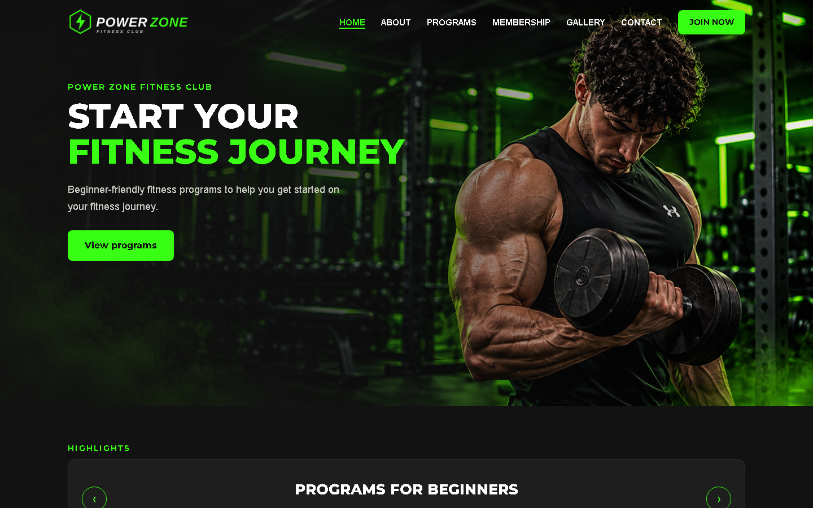
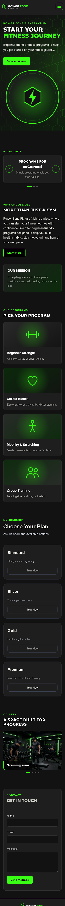
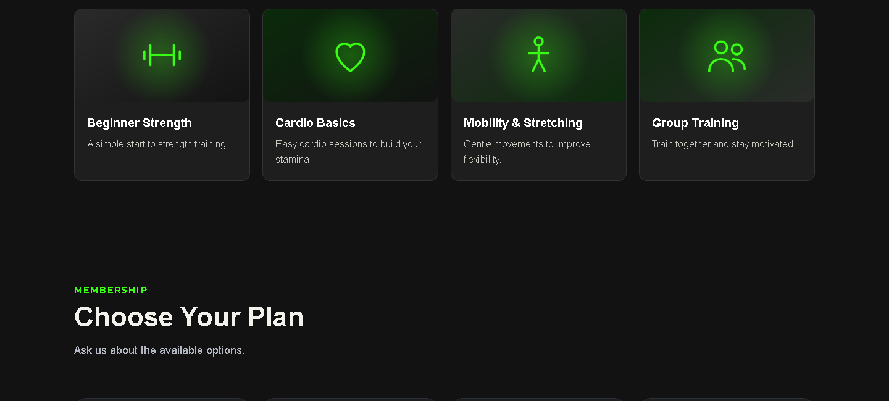
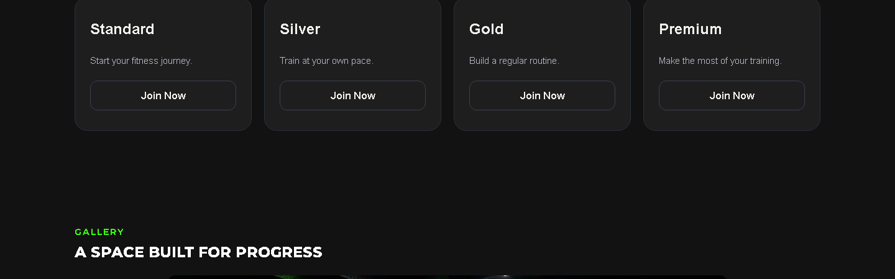
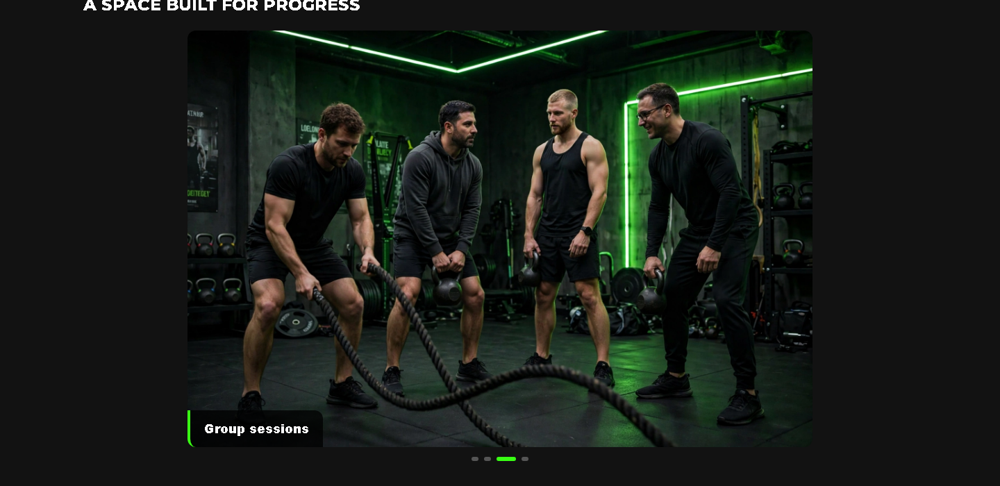
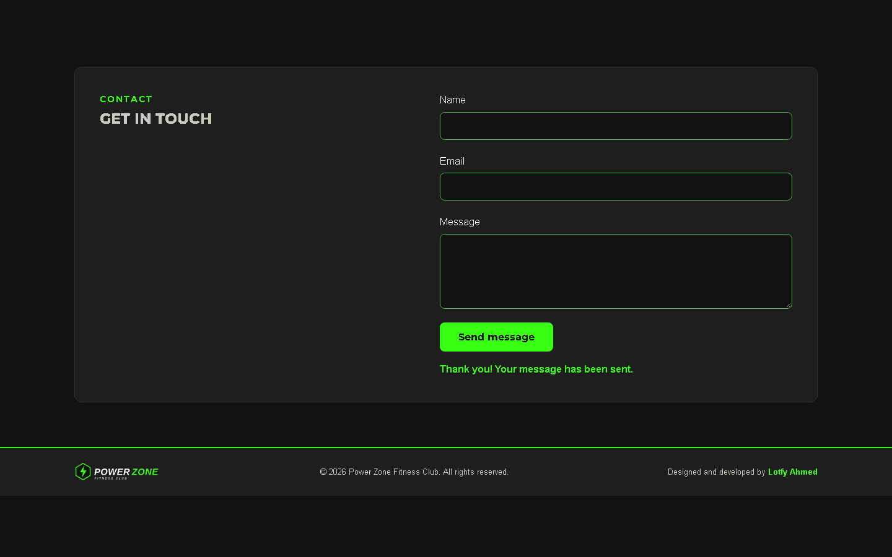

# ⚡ Power Zone | Fitness Club Website

A modern, responsive gym website designed to introduce a fitness club, showcase its training programs, display membership plans, and allow visitors to get in touch.

🌐 **Live Demo:** [Visit Power Zone](https://lotfy-ahmed.github.io/power-zone/)

## 📸 Screenshots

### Desktop Preview


### Mobile Preview


### More Screenshots

| Programs | Membership |
|:---:|:---:|
|  |  |

| Gallery | Contact Form |
|:---:|:---:|
|  |  |

## ✨ Features

- Responsive design for desktop and mobile devices.
- Modern dark theme with neon green accents.
- Interactive navigation menu.
- Dynamic highlights slider with automatic transitions.
- Training programs displayed as dynamic cards.
- Membership plans section.
- Interactive image gallery.
- Contact form with client-side validation.
- Dedicated membership registration page.
- Form validation and user feedback.
- Back-to-top button.

## 🛠️ Built With

- **HTML5** – Website structure and content.
- **CSS3** – Styling, layouts, animations, and responsive design.
- **JavaScript (Vanilla JS)** – Interactive elements and dynamic content.
- **Google Fonts (Montserrat)** – Typography.

## 📁 Project Structure

```text
power-zone/
│
├── index.html
├── join.html
├── style.css
├── script.js
├── join.js
│
├── images/
│   ├── logos
│   ├── hero images
│   └── program images
│
└── screenshots/
    ├── home-desktop.png
    ├── home-mobile.png
    ├── programs-cards.png
    ├── membership-plans.png
    ├── gallery.png
    └── contact-form.png
```

## 🚀 Run Locally

1. Clone the repository:

   ```bash
   git clone https://github.com/lotfy-ahmed/power-zone.git
   ```

2. Open the project folder:

   ```bash
   cd power-zone
   ```

3. Open `index.html` in your browser, or use the VS Code Live Server extension.

## 🎯 Project Goal

This project was built to practice front-end web development, improve JavaScript skills, and create a complete responsive website using HTML, CSS, and JavaScript.

## 👨‍💻 Author

**Lotfy Ahmed**

- GitHub: [@lotfy-ahmed](https://github.com/lotfy-ahmed)

---

⭐ If you like this project, feel free to star the repository!